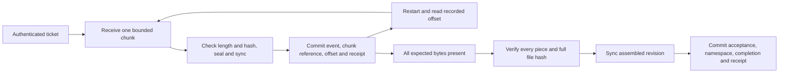

# 0003: resume an owned upload from immutable checkpoints

Accepted for local development. This design adds real resume primitives; it does not complete the browser, outbound delivery, HA, large-file or customer-journey gates.

A ticket fixes the authenticated actor, tenant, partner, mount policy revision, storage identity, target path, parent identity/revision, expected file length and expected SHA-256. Think of it as a numbered receiving job. Each checkpoint is a sealed piece in the vault; PostgreSQL records which pieces belong to that job and the exact contiguous byte offset they cover. A progress number never makes those pieces downloadable files.

Migration 5 adds upload_sessions, upload_chunks and upload_receipts. All thirteen domain relations have forced tenant/partner row policies and are locked/checked by each scoped transaction. Sessions and command receipts are actor-private. Chunk metadata is available to its owner and to an explicitly granted full-root inspector so reconciliation does not mistake another actor's checkpoint for an orphan. This does not grant a chunk-download API.

SQL guards bind exact session fields to their immutable events, enforce revision increments and legal states, require each checkpoint to extend the previous offset, and defer commit validation until its immutable chunk row exists. Chunks and receipts cannot be updated/deleted by runtime. Idempotency keys bind operation, upload identity, offsets, size and digest; changed meaning fails. Replaying a receipt reports its original transition; status reads current state.

Each chunk transaction locks the upload, rechecks destination and actor authority, takes storage admission, stages under a new generated object ID, verifies and syncs bytes, then commits event/index/receipt together. Losing the database transaction cannot authorize a stale process to update the offset. A stale attempt can leave a separate orphan; it cannot alter a recorded piece. This is synchronous request fencing by transaction and immutable object identity. Durable background-worker leases and outbound effect fencing remain separate required work.

The target parent identity/revision is captured by the server, never accepted from request JSON. New writes recheck parent permissions and that snapshot. Publication also rechecks the target file revision. Renaming/replacing a folder or destination cannot redirect a pending upload. A stale intent must be reviewed and recreated; no automatic retarget/rebind is offered.

Migration 6 binds new tickets to a persistent storage UUID. A reproduced bug allowed an upload to put consecutive checkpoints in two roots sharing one database. The root now has a private, synced, atomically published `.freightctl-storage-id` marker. Concurrent initialization agrees on one UUID, and a damaged marker is rejected without replacement. Read-only opening never initializes it. Moving a complete store keeps the marker; copying it into an unrelated directory is not a recovery procedure. All instances of the current single-root profile must use the same configured store. General multi-backend routing and distributed storage qualification remain open.

Migration 5 had already been applied locally when this failure was found, so its bytes were frozen and the repair was added as migration 6. Earlier experimental tickets without a storage binding remain unbound and cannot resume. Existing data/events are preserved; the system does not infer a store from a filename or adopt orphan bytes. Authorized metadata cancellation is available; reviewed recovery/rebinding remains required work.

Completion locks the upload and namespace, verifies the contiguous manifest, reads each immutable piece through its recorded length/hash, assembles one new revision using bounded buffers and a bounded number of open descriptors, and verifies the expected whole-file hash. It syncs the assembled object before the acceptance/publication/completion transaction. SQL also binds completed tickets to the exact actor, upload ID, store ID, length and digest in the acceptance event. Bad contents produce a rejected ticket and no published file. Missing storage remains an explicit failure.

A crash before the offset transaction leaves an unreferenced object, not a checkpoint. A committed offset survives process restart. In-memory SFTP tails are not claimed durable. Checkpoints remain retained after completion/abort/rejection and count against quota; assembly needs additional space for a complete revision. Approved cleanup, retention, compaction, scalable reservations and remaining sync/commit crash boundaries are still open.

Reconciliation distinguishes verified checkpoints from accepted files and reports missing/corrupt checkpoints. Its `consistent` flag means the bounded metadata/disk view agrees; it does not mean a pending upload is accepted, scanned or ready for delivery. Default policy remains integrity-only. A host administrator can defeat local controls; stronger custody and independent retention remain required.
