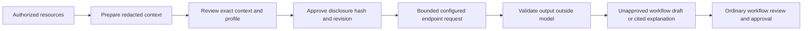

# Assistance control path

Assistance is disabled by default. This repository's owner requires local inference to stay off on the shared machine: no model starts, loads, warmups or local model evaluations. The product contains no model launcher, download or discovery operation. The current checks use a small synthetic JSON responder and real PostgreSQL/HTTPS/workflows. They do not qualify model planning, diagnostic quality, either required private profile or the full AI journeys.

An administrator may eventually configure an authorized inference endpoint within an explicit resource allowance. `--ai-enabled` permits requests to that endpoint; requests can cause the endpoint itself to load or unload a model. It is not permission for this agent to enable a local model. Here it is used only against the isolated synthetic responder during contract checks.



## Configure a profile

`ai-profile-register` is a local administration command requiring `admin` and `ai_manage`. There is no HTTP operation for submitting an endpoint or credential reference. A bounded request file contains `expected_version: 0` and a `definition`:

```json
{
  "schema_version": 1,
  "endpoint": "https://model.customer.example",
  "model": "customer-selected-model",
  "model_digest": "REPLACE_WITH_MANIFEST_SHA256",
  "tokenizer_digest": "REPLACE_WITH_TOKENIZER_SHA256",
  "allow_remote": true,
  "allow_operator_text": false,
  "context_bytes": 8192,
  "context_tokens": 4096,
  "output_tokens": 512,
  "timeout_seconds": 30
}
```

The placeholders must be actual 64-character lowercase hashes. A profile is an immutable administrator-selected configuration, not a qualified model. The transport checks the configured model's manifest digest against the endpoint's bounded `/api/tags` response. The tokenizer hash records the administrator's asset identity; the API does not attest those bytes. Real profile qualification must independently verify assets, license, hardware and quality.

HTTP is restricted to numeric loopback. Other endpoints need HTTPS and explicit `allow_remote`; TLS uses the internal cryptographic policy and normal trust verification. Endpoint user-info, query strings, fragments and path overrides are refused. The client bypasses environment proxies, follows no redirects, accepts no model-selected address and sends no application bearer token or SSH credential. Authenticated provider protocols and custom trust enrollment remain work.

New versions require the profile ID and exact prior `expected_version`; old jobs keep their selected version/hash. `ai-profile-revoke` requires its exact definition hash and state revision. Revocation stops further disclosure and output acceptance. Neither a model answer nor an uploaded document can administer a profile or grant an operation permission.

## Prepare and approve disclosure

All operations use the normal tenant, partner and protected token selectors. `ai-propose` **prepares** a context; it does not call a model. Its input selects a registered profile and exact connection references:

```json
{
  "profile": {"id": "PROFILE_UUID", "version": 1, "hash": "PROFILE_HASH"},
  "name": "reviewed settlement workflow",
  "destinations": [
    {
      "connection": {"id": "CONNECTION_UUID", "version": 1, "hash": "CONNECTION_HASH"},
      "filename": "settlement.csv"
    }
  ]
}
```

Replace the reference placeholders with authorized values. CLI infers `kind: propose`; HTTP `POST .../ai/jobs` requires it explicitly. An optional `requirements` string needs an administrator profile with `allow_operator_text: true`. Freeform text stays off by default. Recognizable credentials, private-key blocks, URLs and long secret-like values are scrubbed before durable context/events. Known file names become destination aliases, preserving ordering such as “second.csv then first.csv” as “d2 then d1”; transport paths, key references and other known private labels are removed. Duplicate names remain ambiguous rather than inventing a mapping.

The model context contains only the reviewed text, supported operation descriptions and aliases such as `d1`. Actual connection IDs, destination names and workflow names stay in separately authorized bindings, outside the prompt. No file body, partner document, raw log, SSH key, credential value or model tool capability is retrieved by this interface. Recognizing secrets in arbitrary text is not automatic proof of its sensitivity: keep text disabled when unnecessary and inspect the exact prepared context before authorizing disclosure. Broader content/name/personal-data policies and retention controls remain required work.

`ai-diagnose` prepares context for one authorized `run_id`, with the profile reference and `kind: diagnose` on HTTP. It derives bounded facts from real run, workflow, connection and delivery records. Event IDs are mapped to aliases such as `e1` in the prompt. The stored bindings retain the actual immutable event references. It does not forward whole journal payloads or general logs.

Preparation requires `ai_use` plus the ordinary resource grants: workflow management for proposals, or workflow access and source read authority for diagnosis. It persists the selected profile, current mount/authority revision, exact resource snapshots, redacted context and original idempotency receipt atomically. All three new tables have forced tenant/partner and restrictive actor row policies. Runtime transactions check all twenty-seven domain relations live.

Inspect `ai-status --ai-job-id ID`. Review the context, profile version/hash, bindings and state. Approve with `ai-approve --ai-job-id ID --context-hash HASH --expected-revision REV --idempotency-key APPROVAL_KEY`. This needs `ai_disclose` as well as `ai_use`. Approval binds exact bytes and state; request text cannot approve itself. Profile, actor authority and current resource snapshots are checked again. The operation approves disclosure only, not a workflow or delivery.

Migration 9 adds `ai_manage`, `ai_use` and `ai_disclose`. Existing accounts keep their prior grants; newly bootstrapped development administrators receive all eighteen grants. The initial ownership model is root-mounted and actor-private. Delegated human lifecycle and separation of duties need further work.

## Generate and validate

`ai-generate --ai-job-id ID --idempotency-key REQUEST_KEY` returns `inference_disabled` by default. It makes no endpoint request and takes no inference capacity slot. Ordinary transfers, workflow operations, context preparation and review remain available.

When a properly authorized deployment explicitly enables endpoint calls, generation first persists an attempt identity and lease before contacting the selected endpoint. Profile/authority/resource checks precede the request, repeat during it and run again before publishing any result. Changed context discards the output as superseded. Revoked authority denies access. No stale proposal can be adopted simply because it once passed a model request.

The [Ollama generate contract](https://docs.ollama.com/api/generate) is the first implemented adapter. It requests non-streaming [structured JSON](https://docs.ollama.com/capabilities/structured-outputs), no thinking output, fixed decoding settings and no resident-model keep-alive. It performs no runtime management or model pull. Response framing, total bytes, completed-generation status, model identity and reported token budgets are checked. Unknown or invalid output is rejected; invalid response text and private reasoning are not stored or returned. Only a response digest, bounded result and explicitly labelled endpoint-reported usage enter records.

For proposals, the model may select an ordering of **all and only** the prepared destination aliases, or report missing/unsupported requirements. It cannot add a connection, path, key, permission, approval, task type or tool. The server expands accepted aliases using the existing authorized bindings and validates the normal typed workflow. This first representation covers the current ordered SFTP task set. It does not silently translate scanning, encryption, schedules or business receipts into a plain delivery.

`ai-adopt` requires the succeeded proposal's exact context hash/state revision and `workflow_manage`. It stages an **unapproved** workflow draft through the same `workflow.StageDraft` checks as ordinary creation. The draft, adoption provenance and idempotency receipt commit together; a failed receipt rolls the whole adoption back. Adoption creates no run, delivery intent or workflow approval. Ordinary explicit workflow review, approval and execution still follow.

For diagnosis, output must select a supported recorded finding and its exact evidence aliases/next check, or abstain for insufficient evidence. Claim validation happens outside the model. Unsupported completion, a forged event or an unsafe resend recommendation is rejected. Explanations come from bounded, evidence-specific templates; they distinguish observed connection failure from possible host/network/identity causes and transport integrity from unknown business acceptance. They do not expose model reasoning. The actual immutable event references are returned as citations that the same authorized context can resolve.

## Retry, bounds and state

Each mutation requires a stable idempotency key. Generation persists its attempt selection before the request. Repeating the same key observes that attempt; it cannot silently trigger another disclosure or retry. A fresh key can retry a failed or expired attempt under current authority, up to two attempts total. Stale workers cannot record over a newer attempt. Endpoint failure is visible; a failed response is never narrated into success.

One PostgreSQL session lock bounds active assistance requests across processes. It uses a separate slot from outbound delivery. There is no waiting inference queue. A disabled request does not reserve that slot. A live slot/authority check cancels the HTTP request if ownership or access is lost. The database pool, HTTP request limits and remote endpoint's independently administered resources remain explicit; this client cannot guarantee that an arbitrary remote server honors cancellation.

| Bound | Current control |
| --- | --- |
| Prepared/open contexts | 64 per actor; historical records retained. |
| Destinations/steps | At most 16, matching the current workflow representation. |
| Context | 8 KiB default; configurable 256 bytes–12 KiB. |
| Operator text | At most 4 KiB; separate administrator policy and exact-context approval. |
| Prompt and response | 16 KiB prompt; 64 KiB HTTP response and 16 KiB selected output. |
| Token request | 4,096 context/512 output default, bounded configuration; reported values checked. |
| Time | 1–60 second endpoint deadline, 65 second call wrapper, 70 second database lease. |
| Requests | One per database; two attempts per job; one connection per endpoint; no redirect/proxy. |
| Parsing | Strict bounded JSON, duplicate/unknown field rejection for model decisions, no script execution. |

Prepared context, citations and validated artifacts remain durable actor-private records. Raw HTTP input, rejected model text and private reasoning are not retained as artifacts. Complete configurable expiry/deletion, protected audit retention, sensitive-content handling and historical recovery/rebinding remain open. A job view identifies when its resource snapshot is historical; adoption requires the current snapshot.

## Interfaces and verification

All HTTP routes use the existing TLS/bearer/tenant/partner prefix:

| Route | Effect |
| --- | --- |
| `GET ai/profiles/ID/VERSION` | Read this actor's configured profile. |
| `POST ai/jobs` | Prepare a proposal or diagnostic context without endpoint contact. |
| `GET ai/jobs/ID` | Inspect the durable context/result and current-snapshot flag. |
| `POST ai/jobs/ID/approve` | Approve exact `context_hash` and `expected_revision`. |
| `POST ai/jobs/ID/generate` | Empty body plus stable key; disabled unless explicitly enabled. |
| `POST ai/jobs/ID/adopt` | Create only a draft from a validated ready proposal. |
| `GET ai/jobs/ID/evidence/EVENT` | Resolve an authorized held citation without arbitrary event payload access. |

CLI commands use those same services. Endpoint registration/revocation stays on local management commands. The production assistance package cannot import `os/exec`; there is no model launcher or shell tool.

`python3 scripts/qualify-assistance.py` starts only a tiny synthetic JSON responder, the ordinary freightctl HTTPS process and a stock OpenSSH fixture. It checks explicit disclosure, disabled-mode zero contact, redaction, known aliases, invalid recipient/authority/citation refusal, stale context and revoked profile denial, actor isolation, generation/adoption replay, and citation resolution. A persisted test response becomes an ordinary unapproved draft; after explicit workflow approval, stock SFTP independently verifies exact bytes with assistance disabled. This proves a control/transport contract and ordinary execution independence. It proves **no inference quality or qualified model**.

Real PostgreSQL tests also cover immutable context/profile bindings, adoption rollback, missing disclosure grants, current-state changes, independent global admission and bounded failed-attempt replay. Fuzzing exercises untrusted output. Package checks run serially to reduce concurrent memory use. The owner resource policy remains in force; no local model is started, loaded, warmed or evaluated.

The complete AI goal remains open: actual private-model proposals and diagnoses, model-disabled replay after real integration, two qualified model/hardware profiles, the required held-out/adversarial datasets and thresholds, wider workflow/migration/content tools, human UI, retrieval/disclosure lifecycle and production resource qualification are still mandatory.
