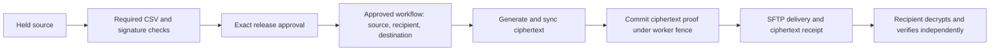

# Approved recipient encryption and SFTP delivery

The sender first releases an exact checked source revision. A separately approved typed workflow selects the destination connection, filename, recipient key version and encryption format together. Its worker encrypts into private custody, syncs the result and journals one immutable ciphertext before opening the receiver connection. Retries send that recorded ciphertext; they do not invent a new envelope or fall back to plaintext.

This adds outbound public-key encryption. Recipient private keys stay at the recipient. Decryption and private signing inside freightctl, malware scanning, other processing tasks, business acknowledgment and complete customer journeys remain required work. An SFTP integrity receipt proves which ciphertext reached the tested remote path. It cannot prove a recipient decrypted, accepted or processed a business transaction.



## Enroll the recipient

Use [the public-key enrollment command](openpgp.md) with an independently confirmed full primary fingerprint and `"purpose":"encrypt"` in the registration request:

```json
{"expected_version":0,"fingerprint":"FULL_PRIMARY_FINGERPRINT","purpose":"encrypt"}
```

`pgp-key-register --request-file REQUEST --pgp-public-file PUBLIC_KEY --idempotency-key KEY` uses ordinary tenant/partner/protected token selectors and requires the root mount, `admin` and `pgp_manage`. HTTPS `POST .../pgp-keys` accepts the same purpose and base64 public bytes. Secret packets remain forbidden. A same-name key has no trust. No network key lookup or private-key request exists.

The key view includes purpose, primary and selected encryption-subkey fingerprints, algorithm family, permitted profiles and effective expiry. Enrollment verifies self/binding signatures, key flags, algorithms and current validity. It freezes the selected encryption subkey as well as the primary key; later selection of another subkey requires another enrolled version. Effective expiry is the earliest relevant primary/binding/encryption-key limit. A verification signer cannot silently become an encryption recipient; an encryption-purpose registration cannot satisfy a signature policy.

Existing registrations with omitted purpose retain their exact verification-only encoding and hashes. New immutable versions allow explicit overlap; revocation is separate and terminal. Registering another key version does not rebind an approved workflow or queued job.

## Review and approve the complete effect

Add `encryption` to an ordinary `sftp.deliver` step:

```json
{
  "id":"send",
  "kind":"sftp.deliver",
  "connection":{"id":"CONNECTION_UUID","version":1,"hash":"EXACT_CONNECTION_HASH"},
  "filename":"settlement.pgp",
  "encryption":{
    "key":{"id":"RECIPIENT_KEY_UUID","version":1,"hash":"EXACT_RECIPIENT_DEFINITION_HASH"},
    "profile":"seipd-v1-aes256"
  }
}
```

The extension is part of the normal immutable workflow definition and approval hash. `workflow-validate` / HTTPS preview resolves the recipient and actual encryption-subkey fingerprints alongside the pinned receiver, directory and filename. Validation contacts no receiver and generates no ciphertext. Draft, diff, approval, revocation, run creation and dispatch retain their ordinary permissions and idempotency. The exact source revision is frozen when creating a run. A malformed, unavailable, expired or revoked recipient cannot be approved or executed; there is no weaker fallback.

Use the exact approved workflow reference in `workflow-run` or `POST .../workflow-runs`, then use `workflow-work` or the normal HTTPS work route. No additional encryption grant is inferred. Key administration uses `pgp_manage`; reviewed execution still requires the existing workflow/read/deliver authority. The current root-mounted, actor-owned lifecycle and loopback SFTP destination restriction remain in force. Broader delegation, UI, schedules and production network profiles remain open.

Two explicit formats are implemented using the library packet serializers behind `internal/crypto`:

| Profile | Required recipient support | Evidence |
| --- | --- | --- |
| `seipd-v1-aes256` | Version-4 recipient, AES-256 preference and SEIPDv1 feature | Independent GnuPG 2.4.9 Curve25519 and RSA3072 recipient profiles |
| `seipd-v2-aes256-ocb` | AES-256/OCB preference and SEIPDv2 feature | Library/unit tests with v4/v6; independent peer qualification remains open |

[RFC 9580](https://www.rfc-editor.org/rfc/rfc9580.html) defines both envelope forms. The older form uses the SHA-1 based MDC integrity mechanism; the newer form uses authenticated chunks. Selecting the newer profile never falls back to the older one. Both use AES-256, fresh random session keys, binary literal bytes, no compression and empty filename/time hints. This profile encrypts for exactly one enrolled recipient, with no hidden/additional recipient or signing identity. Ciphertext exposes protocol metadata and approximate length; no traffic-analysis protection is claimed.

The existing maintained ProtonMail/go-crypto v1.5.2 library performs all public-key/session-key wrapping, symmetric encryption, MDC/AEAD and packet serialization. The application selects policy and bounds streams. The 32-byte session-key buffer has best-effort lock/dump protection and explicit zeroing; library/runtime copies have the existing custody limitations. The plaintext copy buffer is cleared after use. No production process, model, shell command, private key, compression or external key service is involved.

## Persistence, retry and uncertain outcomes

The delivery intent already freezes source, authority, storage UUID, recipient/profile and destination before work. A separate generated object is quota-reserved under the same PostgreSQL custody lock as ordinary acceptance. It is written with a strict output bound, sealed read-only and synced with its directory. A subsequent short transaction rechecks source/authority, current recipient, workflow and live worker fence, then commits the exact `DeliveryCiphertextPrepared` event and immutable projection together. No receiver connection opens before that acceptance succeeds.

Failure before a successful seal removes only that newly generated partial object. After a successful seal, an unsuccessful or uncertain SQL acceptance retains bytes for read-only reconciliation. Without an accepted projection they cannot be delivered. Another attempt may generate a new envelope only if there is no committed artifact and no publication has begun. An accepted artifact is never replaced, including across process restart and a later worker fence. Its actual bytes are hash-verified before every send attempt. Missing or corrupt ciphertext blocks that attempt; it never switches back to the original plaintext.

Run status shows the ciphertext object/length/hash, original source/digest, approved encryption policy, backend and primary/subkey proof. Raw artifact IDs are not accepted file IDs. Ordinary authorized reconciliation recognizes `verified_ciphertext`, `ciphertext_integrity_mismatch` and `missing_ciphertext_bytes`; it does not delete or rebind anything. Artifacts and retained orphans count against the same disk quota. Cleanup, retention, storage reservation fairness and governed repair remain open.

The SFTP worker hashes and observes the ciphertext, not the original plaintext. Its existing sync/hardlink requirements, pinned trust, fences and conservative ambiguity remain unchanged. A crash or failed local receipt after remote publication cannot justify another send or regeneration. Read-only reconciliation compares the exact recorded ciphertext hash at the approved remote path. Delivery receipts retain source and recipient provenance while keeping business acceptance `unknown`.

Recipient revocation or expiry stops queued work and further bounded processing/transfer reads. Whole-run checks also refuse a workflow when another planned recipient is unavailable. Run status keeps an explicit `encryption_recipient_unavailable` observation. Existing received bytes cannot be recalled. A revoked workflow/connection/recipient may require a future governed recovery decision before observation can proceed; the worker does not rewrite old trust or approval. Historical integrity-only and unencrypted workflows retain their recorded scope; this is not retroactive estate-wide encryption enforcement.

Migration 12 adds one immutable actor-bound `delivery_ciphertexts` relation, exact event/fence/source/recipient guards and deferred publication/receipt checks. All thirty domain relations require live forced row security. Tenant-aware foreign keys bind delivery, source and key. Workflow delivery guards require the same encryption definition as the approved step. The nineteen default development grants are unchanged; existing grants are preserved.

## Bounds and qualification

Encryption has two PostgreSQL session slots across processes, separate from the two transfer slots and existing check/inference slots. It releases its encryption slot before acquiring a transfer slot. The local single-root profile serializes generated-byte quota reservation with ordinary acceptance; this is a correctness boundary, not fair multi-tenant storage admission. A busy reservation refuses admission within the existing retry budget.

Source size remains bounded by the configured file limit and 1 GiB maximum. Generated bytes are capped at `source_size + floor(source_size/128) + 65536`, also within the retained-byte quota. No compressed source expansion occurs. Encryption has a 60-second context inside the existing 90-second worker deadline, eight-attempt delivery budget, 30-second database lease and five-second renewal. Plaintext reads check current authority, source, recipient and ownership between at most 32 KiB chunks; v2 AEAD uses 32 KiB chunks. Kernel/filesystem operations and library allocations retain their documented platform limits. No reference throughput, process peak RAM, large-file, production fairness or endurance qualification is implied.

`scripts/qualify-encryption.py` uses real PostgreSQL, stock SFTP ingress/receiver retrieval, separate GnuPG recipient homes, exact plaintext/signature verification, wrong-recipient and tampered-ciphertext refusal, app restart and ciphertext reuse. It kills an actual worker after durable ciphertext sync but before acceptance commits, waits for the unchanged lease and observes the orphan and replacement. It also injects local receipt failure after remote publication, waits for ambiguity and resolves it through read-only observation of the same ciphertext. All faults are scoped to exact task-owned identities and removed afterward.

Synthetic recipient private keys stay in ignored protected fixture files and are imported only inside independent GnuPG containers, capped at 128 MiB, one CPU, no network and temporary key homes. The host/model store is untouched. This is assisted same-host macOS application / Linux peer evidence. It does not qualify a native Linux application, application-side private operations, malware scanning, complete business receipt, independent adoption, multi-host recovery, full cryptographic coverage or release readiness. Local inference stays off.

For the selected real-engine path combining authenticated signed intake, ClamAV, CSV, separate release and this approved encrypted delivery, see [signed/scanned exchange](signed-scanned-exchange.md). The retained ciphertext survives an actual task-runtime restart and is independently retrieved, decrypted and signature-verified. General corpus, production/native platform, full operator journey and stronger business receipts remain separate requirements.
