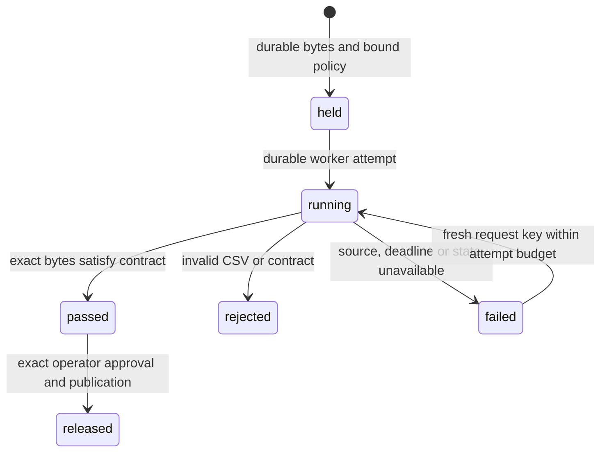

# Held intake and CSV checks

An intake policy applies to **newly accepted revisions** for one tenant and partner. The server chooses the policy; an uploader cannot request a weaker one. Bytes are synced into private custody, then the file, immutable policy binding, held check and upload receipt commit together. No destination path appears yet. Raw file IDs, namespace publication and delivery cannot bypass the hold, including for an administrator.

Durable acceptance means the bytes were saved. It does not mean they passed a business contract, were published or reached a receiver. HTTP upload responses distinguish `durable-held-pending-checks-and-release` from the historical `durable-local-integrity-only` profile. Resumable upload `completed` means assembly finished; its file can still be held. An SFTP CLOSE can acknowledge durable held intake while the destination remains unavailable. Operators find that upload with the private check list.

The first check engine validates a CSV contract. An optional [OpenPGP policy](openpgp.md) additionally requires a detached signature by an explicitly enrolled signer before a pass. Malware scanning, encryption, wider processing tasks and the complete payroll/settlement journey remain required. No model, scanner daemon, shell or network request runs inside the parser or signature verifier.



## Set the intake contract

`intake-policy-register` uses the ordinary tenant, partner and protected token selectors. It requires `admin`, `intake_manage` and the root mount. Supply a bounded request file with the current `expected_version` (zero for the first policy):

```json
{
  "expected_version": 0,
  "definition": {
    "schema_version": 1,
    "kind": "csv",
    "columns": [
      {"name": "account", "type": "text", "required": true, "max_bytes": 64},
      {"name": "amount", "type": "decimal", "required": true, "max_bytes": 64, "precision": 12, "scale": 2},
      {"name": "day", "type": "date", "required": true, "max_bytes": 10}
    ],
    "max_bytes": 16777216,
    "max_rows": 100000,
    "max_record_bytes": 65536,
    "timeout_seconds": 30
  }
}
```

Run `intake-policy-register --request-file REQUEST --idempotency-key KEY` with the normal selectors. `intake-policy-status` returns the selected immutable definition, version, hash and current state. The same services are available through HTTPS. Unknown fields, duplicate keys, unsupported types and invalid bounds are rejected.

The CSV dialect uses UTF-8, comma separators and standard double-quote escaping. The header must match the configured names and order exactly. CRLF and quoted multiline cells are accepted by Go's CSV parser; blank physical lines are ignored. Validation never rewrites the stored file. Reports count logical data records, excluding the header, and identify a failing logical record/column without retaining its cell contents.

`text` preserves identifiers and leading zeros. `integer` permits an optional sign and ASCII digits without converting the value. `decimal` permits an optional sign, digits and one decimal point; precision bounds significant digits and scale bounds fractional digits. It uses no floating-point conversion, rounding or scientific notation. `date` requires a real `YYYY-MM-DD` calendar date. Required empty cells, NULs, invalid UTF-8, excessive field lengths, wrong field counts and malformed quotes are rejected. Wider schemas, other encodings/dialects, XML/JSON/spreadsheets/EDI and deterministic transformations remain work.

There is one current intake policy per partner. Registering the next exact version retires its predecessor. Revocation requires `definition_hash`, `expected_version` and `expected_revision`; use `intake-policy-revoke --request-file DECISION --idempotency-key KEY`. A revoked policy blocks new acceptance. It cannot silently restore the unchecked profile. In-progress staging holds the selected policy until its acceptance transaction ends; a concurrent policy change can wait or time out and must be retried under its original key.

**Existing integrity-only revisions retain their original scope.** Installing a policy does not invent historical validation results or turn old files into checked files. An idempotent upload replay also retains its original acceptance. Use a fresh key and new revision to enter the new policy. Retroactive policy application, re-scan and governed rebind remain open; do not treat this intake control as an estate-wide malware or DLP policy.

## Inspect, check and release

`check-list --check-limit 50 --check-after LAST_FILE_ID` returns bounded actor-private summaries. Use its `next` cursor for another page. SFTP operators can match the held target path to its immutable file ID. `check-status --file-id FILE_ID` shows the binding, state, report and whether its authority/resource metadata is current. The flag does not hash the stored bytes on every metadata read.

`check-run --file-id FILE_ID --idempotency-key KEY` requires `read` and `check_run`. It verifies the storage UUID, accepted length/hash, actor authority, mount, target parent/revision and exact current policy. It then persists a worker identity and attempt before parsing. The response is an attempt receipt; inspect `check-status` for the verdict. A repeated key returns the same attempt without parsing again. A fresh key may retry a failed or expired attempt, up to three total. Rejected content needs a new revision; no force-clean operation exists.

The engine reads all accepted bytes before a pass, hashes them again during parsing and compares their exact length and SHA-256. Its report binds the file ID/digest, policy hash, engine version, counters and code. Failed or unavailable processing is never a clean result. No offending cell values or original parser error strings enter the report or journal.

A `passed` file remains unavailable. Review it and run `check-release --file-id FILE_ID --request-file DECISION --idempotency-key KEY` with:

```json
{
  "sha256": "EXACT_ACCEPTED_FILE_SHA256",
  "policy_hash": "EXACT_INTAKE_POLICY_SHA256",
  "report_hash": "EXACT_PASSING_REPORT_SHA256",
  "expected_revision": 3
}
```

Use the actual hashes and current revision from `check-status`. Release needs `read`, `write` and `check_release`. It rechecks authority, target/parent revisions, current policy, storage identity and the actual bytes. The release transition, minimal release proof, optional namespace publication and original command receipt commit in one transaction. A failed receipt rolls the entire release back. It creates no workflow run, delivery or external acknowledgment. Ordinary workflow review/approval and delivery still follow.

Check bindings and reports are actor private. A released path can be read by another normally authorized partner identity; the shared release proof contains only the minimum file/policy/result identifiers needed for that gate. It exposes no private intake target, authority snapshot or cell data. Changing or revoking the selected policy makes its controlled revisions unavailable, including through an open SFTP/HTTP reader's next bounded read. It cannot retract bytes a recipient already received. Plan policy transitions with current transfers and retained held revisions in view; automated policy rebind and delegated review remain open.

## Persistence and bounds

Migration 10 adds `intake_policies`, `file_checks`, `file_releases` and `check_receipts`, with forced tenant/partner row security; checks and command receipts also enforce actor restriction. Migration 11 adds two signature/key relations and migration 12 adds one ciphertext relation; all thirty domain relations are checked live. Exact event guards bind policy/check transitions and release proofs. Deferred SQL checks require a new controlled acceptance and its bound check in the same transaction, and reject new unchecked acceptance after policy configuration. SQL publication/delivery guards also refuse held bytes.

The grants `intake_manage`, `check_run` and `check_release` are explicit. Existing accounts keep their old grants. Newly bootstrapped development administrators receive nineteen grants, including the separate `pgp_manage` grant. The current workflow is actor owned; an upload-only sender and a separate delegated reviewer need further identity/lifecycle work.

| Bound | Current behavior |
| --- | --- |
| Admission | At most 128 unreleased checks per actor; retained rejected/failed checks count. |
| Parsing workers | Two independent PostgreSQL slots across processes; no waiting parse queue. |
| Attempts | Three per check; 70-second database lease, worker identity and revision fencing. |
| Deadline | Configured 1–60 seconds; bounded final recording after cancellation. |
| File | Policy 1 byte–1 GiB, also constrained by the deployment's existing custody quota. |
| Data records | 1–1,000,000 maximum; no minimum data-record count is asserted. |
| Contract | 1–128 columns; canonical definition at most 12 KiB. |
| Field | At most 64 KiB and no more than the record budget. |
| Record | 64 bytes–1 MiB; a reader budget bounds parser allocation before an unterminated record can grow with the file. Exact offsets enforce the selected record limit. |
| HTTP/SFTP reads | Current authority and release gate checked before each bounded descriptor read; HTTP ranges use the same verified descriptor. |

Processing slots are separate from outbound transfer and disabled inference slots. Cancellation is checked between bounded filesystem reads; the client cannot cancel a kernel/filesystem operation that never returns. Late workers cannot publish over a newer result. Protected retention, cleanup, rejected-file handling, configurable fairness/queues, automatic workers and distributed-storage outage qualification remain required. Retained bytes and raw evidence stay out of Git.

## Native verification

`python3 scripts/qualify-intake.py` uses real PostgreSQL, stock curl and OpenSSH SFTP, the shared CLI/HTTPS services and a separate stock receiver. It checks all three intake paths, restart while held, raw-ID/publication/dispatch denial, explicit release, invalid CSV, current-policy denial and exact receiver bytes. It pauses one actual worker, waits for the unchanged database lease, lets a second process complete under a new identity, and resumes the old worker to verify that its result is refused. Original attempt replay stays attached to its original attempt.

Real database regressions also cover receipt-failure rollback, private row visibility, shared authorized reads, wrong storage, changed bytes, stale policy/authority and SQL bypass attempts. Fuzzing and adversarial record tests cover parser bounds. These are local assisted checks, not a complete secure-file journey, malware qualification, resource benchmark, independent operator adoption or release qualification. Local inference remains off.
